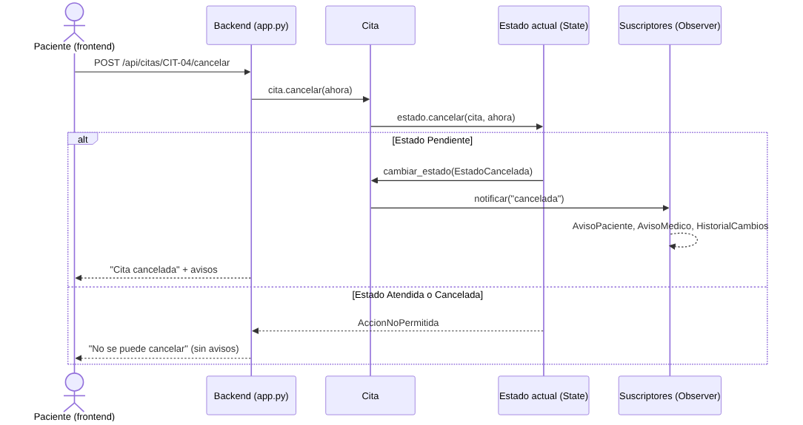
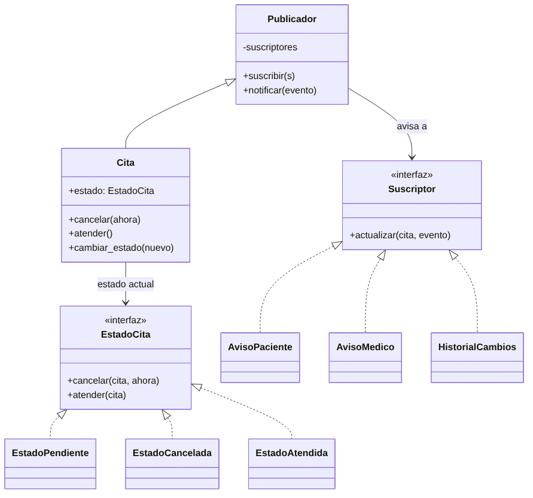
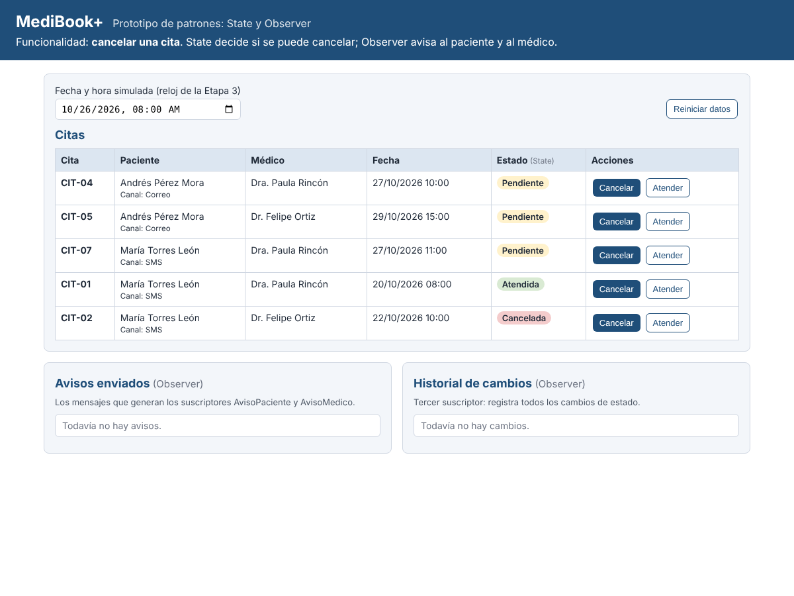
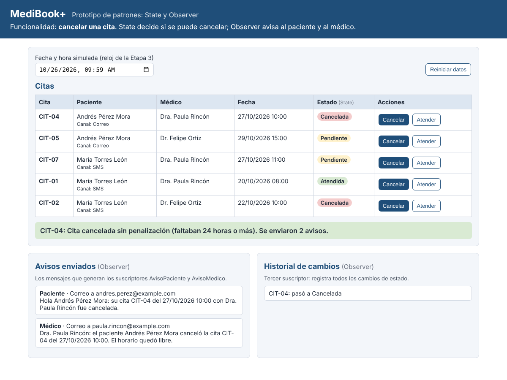
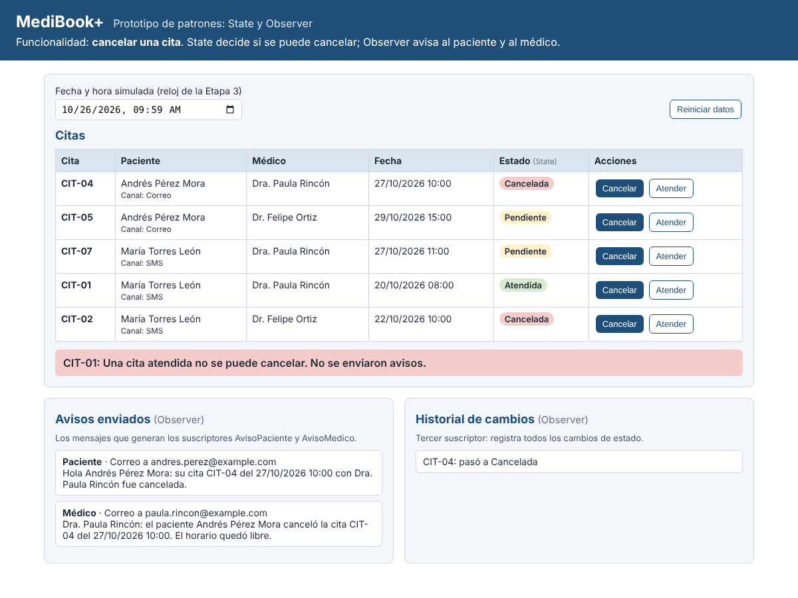
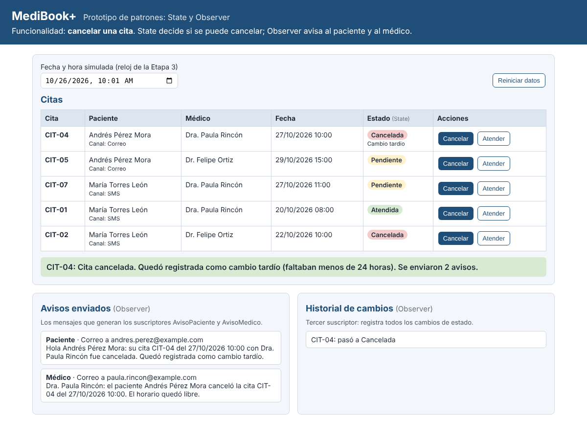

# MediBook+ · Prototipo de patrones de diseño: State y Observer

Taller de patrones de diseño, punto 3 (prototipo funcional). Diseño Detallado de Software, Mg. Leidy Jaramillo.

Este prototipo programa **una sola funcionalidad de MediBook+: cancelar una cita**. Con ella se resuelven los dos problemas de la tabla final del taller:

| Patrón | Tipo | Problema que resuelve | Dónde está en el código |
|---|---|---|---|
| [State](https://refactoring.guru/es/design-patterns/state) | Conductual (de comportamiento) | **C2.** Una cita pasa por estados (Pendiente, Cancelada, Atendida) y cada estado permite cosas distintas. | `dominio/estados.py` y `dominio/cita.py` |
| [Observer](https://refactoring.guru/es/design-patterns/observer) | Conductual (de comportamiento) | **A3.** Cuando se cancela una cita, el paciente y el médico deben enterarse. | `dominio/observadores.py`, `dominio/cita.py` y `dominio/datos.py` |

En pocas palabras: **State decide si la cita se puede cancelar, y Observer avisa a los interesados cuando la cancelación ocurre.**

---

## 1. Cómo ejecutarlo

Se necesita Python 3.10 o más reciente.

```bash
# 1. Entrar a la carpeta del proyecto
cd medibook_patrones

# 2. (Opcional) crear un entorno virtual
python -m venv venv
venv\Scripts\activate          # en Windows
# source venv/bin/activate     # en Mac o Linux

# 3. Instalar Flask, la única librería que se usa
pip install -r requirements.txt

# 4. Encender el servidor
python app.py
```

Después se abre el navegador en **http://127.0.0.1:5000**.

Para correr las pruebas automáticas (no necesitan el servidor encendido):

```bash
python -m unittest -v
```

Deben salir **10 pruebas en OK**.

---

## 2. Cómo está organizado: frontend y backend

```
medibook_patrones/
├── app.py                  BACKEND: servidor web (Flask). Recibe las peticiones y llama al dominio.
├── dominio/                LÓGICA DE NEGOCIO: aquí viven los dos patrones.
│   ├── estados.py          Patrón STATE: un archivo con una clase por estado.
│   ├── observadores.py     Patrón OBSERVER: publicador, suscriptores y bandeja de avisos.
│   ├── cita.py             La clase Cita, que une los dos patrones.
│   └── datos.py            Datos de prueba de la Etapa 3 y armado de los suscriptores.
├── static/                 FRONTEND: lo que ve el usuario en el navegador.
│   ├── index.html          La página.
│   ├── app.js              Llama al backend y muestra los resultados.
│   └── styles.css          Colores y diseño.
├── tests/test_patrones.py  10 pruebas automáticas basadas en los casos CP-311 de la Etapa 3.
└── docs/                   Capturas de pantalla del prototipo funcionando.
```

**¿Qué hace cada parte?**

- **Frontend** (`static/`): muestra la tabla de citas con botones "Cancelar" y "Atender", la lista de avisos enviados y el historial de cambios. **No tiene reglas de negocio**: los botones siempre envían la acción al backend, sin revisar el estado. Por eso se ve claro que quien acepta o rechaza es el patrón State.
- **Backend** (`app.py`): es un servidor Flask con cinco direcciones:

| Dirección | Qué hace |
|---|---|
| `GET /` | Entrega la página (frontend). |
| `GET /api/citas` | Devuelve las citas, los avisos y el historial. |
| `POST /api/citas/<id>/cancelar` | Intenta cancelar una cita (State decide; Observer avisa). |
| `POST /api/citas/<id>/atender` | Marca una cita como atendida (sirve para probar los estados). |
| `POST /api/reiniciar` | Vuelve los datos al estado inicial (supuesto S-05 de la Etapa 3). |

- **Dominio** (`dominio/`): aquí están los patrones. El backend solo llama a `cita.cancelar(...)` y no sabe nada de estados ni de avisos.

**Datos:** son los datos sintéticos de la Etapa 3 (sección 5): PAC-02 Andrés Pérez (canal correo), PAC-03 María Torres (canal SMS), MED-01 Dra. Paula Rincón, MED-02 Dr. Felipe Ortiz y las citas CIT-01, CIT-02, CIT-04, CIT-05 y CIT-07. El reloj arranca en el T0 de la Etapa 3: **26/10/2026 08:00**, y se puede cambiar en la pantalla para probar la regla de las 24 horas.

---

## 3. Patrón State: cómo se ve en el código (problema C2)

### El problema

Una cita puede estar Pendiente, Cancelada o Atendida, y cada estado permite cosas distintas: una cita pendiente se puede cancelar, pero una atendida o una ya cancelada no (US-311; CP-311-04). Sin el patrón, el método cancelar quedaría así:

```python
# SIN el patrón (lo que se EVITA)
def cancelar(self):
    if self.estado == "Pendiente":
        ...
    elif self.estado == "Atendida":
        raise Error("no se puede")
    elif self.estado == "Cancelada":
        raise Error("ya está cancelada")
    # y lo mismo en atender(), reprogramar(), ... 
```

Cada acción nueva repite estos "si… entonces…", y es fácil olvidar un caso.

### La solución con State

**1. Una interfaz común con las mismas acciones** (`dominio/estados.py`, clase `EstadoCita`, línea 20):

```python
class EstadoCita(ABC):
    def cancelar(self, cita, ahora): ...
    def atender(self, cita): ...
```

**2. Una clase por estado.** Cada una decide qué hacer con cada acción:

| Clase | `cancelar` | `atender` |
|---|---|---|
| `EstadoPendiente` (línea 34) | **Sí cancela.** Revisa las 24 horas, marca si fue tardía y pasa la cita a `EstadoCancelada`. | Pasa la cita a `EstadoAtendida`. |
| `EstadoCancelada` (línea 57) | Rechaza: "Esta cita ya está cancelada." | Rechaza. |
| `EstadoAtendida` (línea 69) | Rechaza: "Una cita atendida no se puede cancelar." | Rechaza. |

**3. La cita guarda su estado como objeto y le pasa la acción** (`dominio/cita.py`, líneas 19 a 27):

```python
self.estado = estado                 # el estado actual es un OBJETO

def cancelar(self, ahora):
    return self.estado.cancelar(self, ahora)   # la cita NO decide; decide su estado
```

**Dónde se evidencia:** la clase `Cita` no tiene ni un solo `if` sobre el estado. Si mañana se agrega el estado "No asistió", se crea una clase nueva y la `Cita` no cambia.

### La regla de las 24 horas (DEF-08)

Dentro de `EstadoPendiente.cancelar` (línea 39) está la regla corregida en la Etapa 2: con 24 horas o más no hay penalización, y con menos de 24 horas se cancela, pero queda como **cambio tardío**. Por eso los valores límite de la Etapa 3 se pueden probar en la pantalla:

| Caso de la Etapa 3 | Reloj | Resultado |
|---|---|---|
| CP-311-01 | 26/10/2026 09:59 (faltan 24 h 01 min) | Cancelada sin penalización |
| CP-311-02 | 26/10/2026 10:00 (faltan 24 h exactas) | Cancelada sin penalización |
| CP-311-03 | 26/10/2026 10:01 (faltan 23 h 59 min) | Cancelada como cambio tardío |
| CP-311-04 | Cualquiera, sobre CIT-01 (Atendida) | Rechazada |

---

## 4. Patrón Observer: cómo se ve en el código (problema A3)

### El problema

Cuando se cancela una cita hay que avisar al paciente y al médico (US-311 y la retroalimentación de la Etapa 1). Sin el patrón, la cita llamaría a cada aviso directamente:

```python
# SIN el patrón (lo que se EVITA)
def cancelar(self):
    ...
    enviar_correo_al_paciente(...)
    enviar_correo_al_medico(...)
    guardar_en_historial(...)       # cada interesado nuevo obliga a tocar este código
```

### La solución con Observer

**1. El publicador** (`dominio/observadores.py`, clase `Publicador`, línea 23): guarda la lista de suscriptores y les avisa a todos. **No sabe qué hace cada uno.**

```python
def notificar(self, evento):
    for suscriptor in self._suscriptores:
        suscriptor.actualizar(self, evento)
```

**2. Los suscriptores** (mismo archivo): todos tienen el método `actualizar` y cada uno reacciona a su manera.

| Suscriptor | Qué hace cuando la cita cambia |
|---|---|
| `AvisoPaciente` (línea 54) | Si la cita se canceló, le avisa al paciente **por su canal preferido**: correo para PAC-02 y SMS para PAC-03. Si fue tardía, lo dice en el mensaje. |
| `AvisoMedico` (línea 71) | Si la cita se canceló, le avisa al médico que su horario quedó libre. |
| `HistorialCambios` (línea 86) | Registra **todos** los cambios, cancelada o atendida. Es el ejemplo de "agregar otro interesado sin tocar la cita". |

**3. La cita es el publicador.** `Cita` hereda de `Publicador` (`dominio/cita.py`, línea 12) y, cuando cambia de estado, **solo anuncia el evento** (línea 33):

```python
def cambiar_estado(self, nuevo_estado):
    self.estado = nuevo_estado
    self.notificar(nuevo_estado.nombre.lower())    # "cancelada" o "atendida"
```

**4. Los suscriptores se apuntan afuera de la cita** (`dominio/datos.py`, líneas 48 a 50):

```python
cita.suscribir(aviso_paciente)
cita.suscribir(aviso_medico)
cita.suscribir(self.historial)
```

**Dónde se evidencia:** la clase `Cita` no conoce a `AvisoPaciente`, `AvisoMedico` ni `HistorialCambios`. Para agregar, por ejemplo, el envío a la historia clínica electrónica (DEF-16), basta crear un suscriptor nuevo y apuntarlo con `suscribir`. La prueba `test_agregar_un_suscriptor_nuevo_sin_tocar_la_cita` lo demuestra.

---

## 5. Cómo trabajan juntos los dos patrones





Paso a paso:

1. El paciente pulsa "Cancelar" en la pantalla (**frontend**).
2. El **backend** recibe la petición y llama a `cita.cancelar(ahora)`.
3. La cita le pasa la acción a su estado actual (**State**).
4. Si el estado es Pendiente, cancela y cambia la cita a Cancelada. Si es Atendida o Cancelada, la rechaza.
5. Solo si la cita cambió, la cita anuncia el evento y los suscriptores reaccionan (**Observer**).
6. El frontend muestra el mensaje, los avisos y el historial.

Un detalle importante: si State rechaza la cancelación, **no se envía ningún aviso**, porque la cita no cambió y no hay nada que anunciar.

---

## 6. Pruebas automáticas

Están en `tests/test_patrones.py` y usan los casos de la Etapa 3:

| Prueba | Qué comprueba | Patrón |
|---|---|---|
| `test_cp_311_01_cancelar_con_24_h_01_min` | Se cancela sin penalización. | State |
| `test_cp_311_02_cancelar_con_24_h_exactas` | A las 24 h exactas tampoco hay penalización. | State |
| `test_cp_311_03_cancelar_con_23_h_59_min` | Queda como cambio tardío. | State |
| `test_cp_311_04_no_se_cancela_una_cita_atendida` | Una cita atendida no se cancela. | State |
| `test_no_se_cancela_dos_veces` | Una cita cancelada no se vuelve a cancelar. | State |
| `test_cancelar_avisa_al_paciente_y_al_medico` | Llegan los 2 avisos; PAC-02 recibe por correo. | Observer |
| `test_paciente_con_sms_recibe_por_sms` | PAC-03 recibe por SMS. | Observer |
| `test_si_state_rechaza_no_hay_avisos` | Si State rechaza, no hay avisos. | Los dos |
| `test_historial_registra_todos_los_cambios` | El historial registra también "atendida". | Observer |
| `test_agregar_un_suscriptor_nuevo_sin_tocar_la_cita` | Un suscriptor nuevo funciona sin cambiar `Cita`. | Observer |

---

## 7. Capturas del prototipo funcionando

**Inicio:** las cinco citas con su estado.



**CP-311-01:** se cancela CIT-04 con el reloj en 26/10/2026 09:59. State la acepta y Observer genera el aviso al paciente (por correo) y al médico.



**CP-311-04:** se intenta cancelar CIT-01, que está atendida. State la rechaza y no se envían avisos.



**CP-311-03:** con el reloj en 26/10/2026 10:01 faltan 23 h 59 min. Se cancela, pero queda como cambio tardío, y el aviso al paciente lo menciona.



---

## 8. Cómo mejora el diseño

- **Fácil de cambiar:** un estado nuevo es una clase nueva, y un aviso nuevo es un suscriptor nuevo. En ninguno de los dos casos se toca la clase `Cita`.
- **Menos errores:** cada regla está en un solo lugar. No hay "si… entonces…" repetidos que se puedan olvidar.
- **Se puede probar por partes:** cada estado y cada suscriptor se prueban solos, como se ve en las 10 pruebas.
- **Experiencia de usuario:** el paciente y el médico se enteran en el momento en que la cita se cancela, y el paciente recibe el aviso por el canal que eligió.

## 9. Uso de inteligencia artificial

Se usó Claude como asistente para generar una primera versión del código, los comentarios y las pruebas a partir de la tabla final del taller y de los datos de la Etapa 3. El equipo revisó que cada clase correspondiera al patrón elegido, ejecutó las pruebas y probó el flujo en el navegador.
